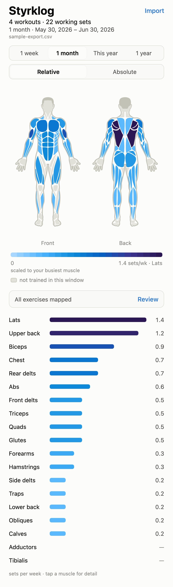

# Styrklog

Turns a [StrengthLog](https://www.strengthlog.com/) CSV export into a front/back muscle
heat map, so you can see which muscle groups your training neglects.

Fully client-side: the CSV is parsed in memory and never leaves the device. No backend,
no analytics — the only state it keeps is a local cache of your last import, so
reopening the app doesn't start empty.



## Development

```bash
npm start          # Expo dev server, opens in the browser
npm test           # unit tests
npm run typecheck
```

## How it works

- **Metric:** hard sets per muscle per week. Warm-ups are excluded; a set counts 1.0
  toward primary muscles and 0.5 toward secondary ones.
- **Windows:** 1 week, 1 month, this year (from 1 January), 1 year. They are anchored to
  the most recent workout in the file, not to today.
- **Colour scales:** *Relative* divides by your busiest muscle. *Absolute* divides by a
  fixed 20 sets/week. Muscles with no sets render neutral grey, never as the "coldest".
- **Exercise mapping:** an explicit table, then keyword heuristics for unknown names.
  Guessed and unmapped exercises are listed in the app's coverage sheet.

## Deploying

Styrklog is a home-screen web app — no App Store, no signing.

```bash
npm run build:web   # -> dist/
```

Serve `dist/` from the root of an HTTPS host (Vercel builds it from `vercel.json`). On
the phone, open the URL in Safari and choose Share → Add to Home Screen. It works
offline afterwards.

iOS does not support the Web Share Target API, so the app cannot appear in
StrengthLog's share sheet. Export to Files, then import from within Styrklog.

## Privacy

Real exports contain bodyweight and a dated training history, so they are never
committed. `fixtures/*.csv` is gitignored except `fixtures/sample-export.csv`, a
synthetic file generated by `scripts/make-fixture.mjs`.

The last imported CSV is cached in the browser's own localStorage — on-device only,
never sent anywhere, and cleared like any other site data.
